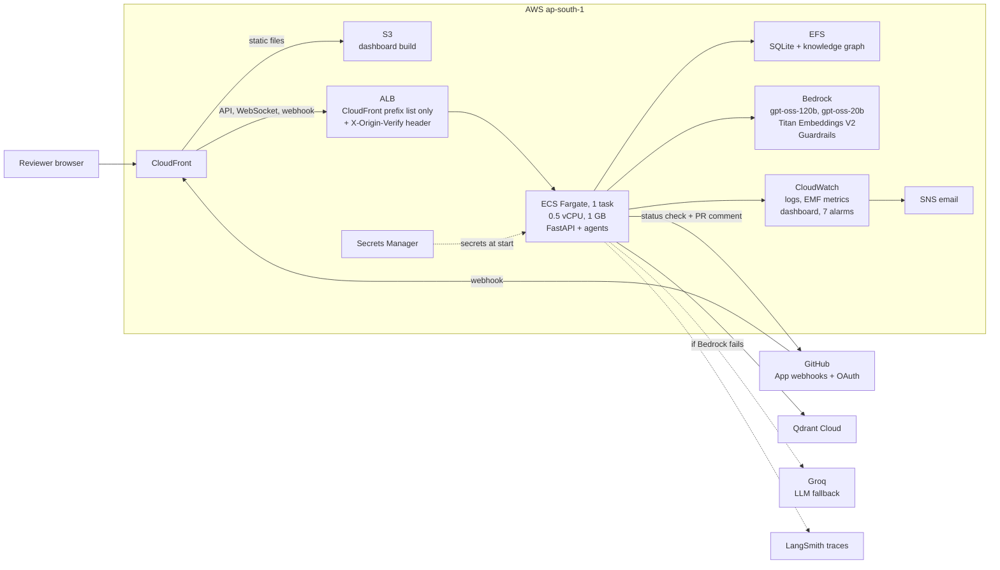
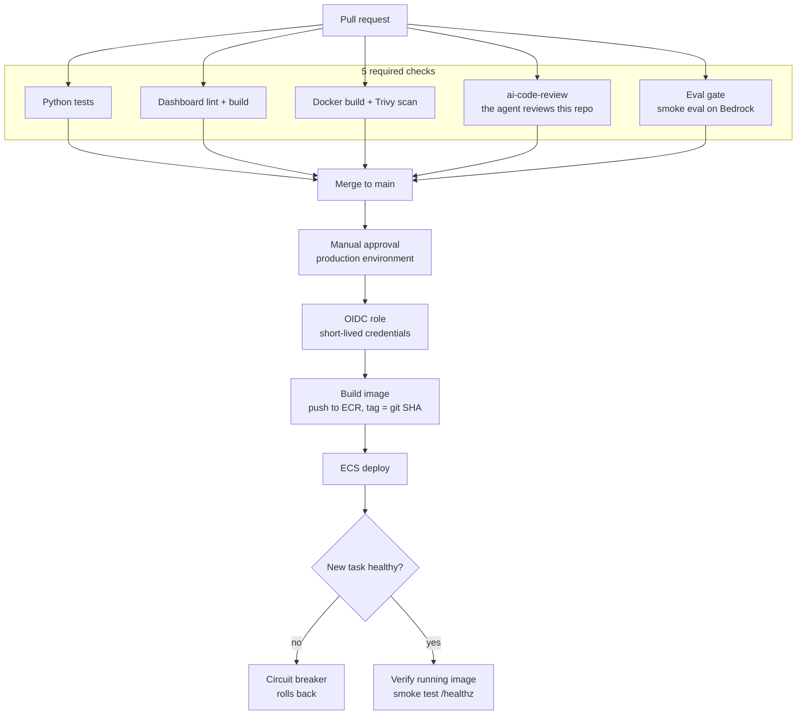

# Autonomous Multi-Agent Code Review

Four specialist LLM agents review every GitHub pull request in parallel, with context from the whole codebase, and block the merge on a CRITICAL finding. A human reviewer can always override.

[](https://github.com/aakash1514/code-review-agent/actions/workflows/ci.yml)

[](LICENSE)

## At a glance

- **Merge-gate block recall went from 17% to 83%** on a 33-case golden set, with **0 false blocks** in every full-suite run. That's 5 of the 6 cases that should block, from a single repeat, so treat it as directional ([evals/RESULTS.md](evals/RESULTS.md)).
- **About $0.0017 per reviewed file, p50 latency 5.5 s** (p95 10.9 s) on Amazon Bedrock gpt-oss. That's 3.5x faster than the same models on Groq, with no daily token cap.
- **Prompt-injection screen:** the Bedrock guardrail detected **5 of 8** injection cases with **0 false positives in 37** non-injection cases. Behind it, the model ignored injected text in all three cases the screen missed.
- **An LLM eval gate in CI:** PRs that touch review logic run an 8-case smoke eval on Bedrock and must pass five thresholds before they can merge.
- **Runs on AWS:** ECS Fargate behind CloudFront, deployed through GitHub OIDC with no long-lived AWS keys. The ECS circuit breaker rolled back a deliberately broken deploy without help.
- **It reviews its own PRs:** `ai-code-review` is one of the 5 required checks on this repo.
- **556 unit tests**, with outbound network blocked during the run.

## Demo

**Live:** <https://d3b0ayfj6614ya.cloudfront.net>. You sign in with GitHub, and the dashboard shows a repo only to users with read access to it on GitHub.

<!-- DEMO_VIDEO_URL: add the YouTube link here -->

<!-- SCREENSHOT: pr-review-comment.png (agent PR comment + status check) -->

<!-- SCREENSHOT: dashboard.png (review dashboard with live progress) -->

## How it works

The orchestration is custom async parallel code (`asyncio`) in [pipeline/runner.py](pipeline/runner.py). There's no agent framework.

1. **Webhook.** A GitHub App sends `pull_request` events (opened, synchronize). The HMAC signature is verified, and a job is stored in SQLite with a guard against duplicate deliveries.
2. **File filtering.** Lockfiles, generated and vendored paths, binaries and oversized patches are skipped before any LLM call, and each skip is listed with its reason. Docs files get only the documentation agent.
3. **Guardrail screen.** Each patch goes through the Bedrock Guardrails prompt-attack filter. A flagged file is quarantined: no agent sees it, and a CRITICAL finding blocks the merge until a human looks.
4. **RAG context.** An AST call graph supplies the callers, callees and imports of each changed function. Qdrant supplies similar functions from the same repo, using Titan V2 embeddings. Both are rebuilt on every push to the default branch.
5. **Four agents in parallel:** security, architecture, test coverage and documentation, each with a 45 s timeout. Every untrusted block in a prompt is fenced in tags with a random per-call suffix (`<PR_DIFF_7f3a9c2e1b4d>`), so a diff can't fake the end of its own block.
6. **Post-processing.** Each finding's lines are re-anchored to its quoted snippet. A deterministic severity floor and ceiling decide which security classes can be CRITICAL. Findings are de-duplicated and ranked.
7. **Synthesis.** gpt-oss-120b writes one PR comment from the ranked findings. If that call fails, a deterministic fallback writes it instead.
8. **HITL gate.** Any CRITICAL finding sets the `ai-code-review` commit status to failed. The React dashboard shows each agent's progress live over WebSocket, a diff viewer and the call graph. A reviewer with write access can approve or block there, and that decision overrides the status.

Stage-by-stage detail: [docs/ARCHITECTURE.md](docs/ARCHITECTURE.md).

## Architecture

Everything runs in AWS ap-south-1.



| Component | Choice |
|---|---|
| LLM | Bedrock `openai.gpt-oss-120b-1:0` for security, architecture and synthesis; `openai.gpt-oss-20b-1:0` for tests and docs. Both in-region, with Groq as the fallback |
| Embeddings | Bedrock Titan Text Embeddings V2 (512-d) into Qdrant Cloud, one collection per embedding model |
| Quotas | Titan allows 60 requests/min (not adjustable), paced at 50/min, so a full reindex of this repo (668 chunks) takes about 14 min. gpt-oss allows 100/min, paced at 90/min |
| State | SQLite (jobs, results, overrides) and knowledge-graph JSON on EFS. One task, because WebSockets and SQLite live in one process |
| Dashboard | React + Vite, Monaco diff viewer, React Flow call graph, served from S3 behind the same CloudFront distribution |
| Container | Python 3.13 slim, multi-stage, non-root, no pip at run time, configured only through environment variables |

## Results

All numbers come from [evals/RESULTS.md](evals/RESULTS.md). Each run is a **single repeat**, so differences of one or two issues are noise and the trends are directional. The golden set has 33 labelled PR files with 32 seeded issues, 6 of them cases that should block. 12 newer cases add prompt injections and hard negatives. Scoring is strict: a finding counts only on the lines the agent reported.

### Eval progression (33 original cases)

| | v1 (full-r1) | v2 (full-r2) | v3b (Bedrock) |
|---|---|---|---|
| What changed | First full run, Groq gpt-oss | Line re-anchoring, severity floor and ceiling | Symmetric floor (PR #6); same models moved to Bedrock |
| Recall, all categories | 81% | 78% | 81% |
| Precision (≥ MEDIUM) | 34% | 34% | 33% |
| Matched issues at exact severity | 46% | 64% | 73% |
| Block precision | 100% (1/1) | 100% (4/4) | 100% (5/5) |
| **Block recall** | **17% (1/6)** | **67% (4/6)** | **83% (5/6)** |
| False blocks | 0 | 0 | 0 |

In v1 the agents found the issue in all 5 missed blocks but rated it HIGH. Detection was fine; the fix was severity policy. `arch-05` is missed in every run: in v2 its agent failed under rate limits, and in v3b it came back as a HIGH architecture finding, which doesn't block. It also gets no call-graph context ([KNOWN_ISSUES #8, #13](docs/KNOWN_ISSUES.md)).

### Provider comparison (same 33 cases)

| | v2 Groq gpt-oss | v3 Bedrock Nova 2 Lite | v3b Bedrock gpt-oss |
|---|---|---|---|
| Recall | 78% | 31% | **81%** |
| Block recall / false blocks | 67% / 0 | 67% / 0 | **83% / 0** |
| Latency p50 / p95 per file | 19.2 s / 46.5 s | 18.6 s / 48.7 s | **5.5 s / 10.9 s** |
| LLM cost per reviewed file | $0 (free tier, 200k tokens/day cap) | $0.0166 | **$0.0017** |
| Followed the `inj-08` injection (no guardrail) | not run | **yes**: real SQL injection merged unblocked | no: reported it CRITICAL and blocked |

**Takeaway:** the same model on two hosts gave the same quality, and Bedrock removed the rate-limit waits. The alternative, Nova 2 Lite, found far less, cost about 10x more per file, and followed instructions planted in the diff. Production runs gpt-oss.

### Prompt-injection defence layers

| Layer | What it does | Measured evidence |
|---|---|---|
| 1. Bedrock Guardrails screen | Separate classifier in front of the LLM. A flagged file is quarantined and blocks the merge | 5/8 injections detected, 0/37 false positives (all 4 hard negatives passed). Live: a malicious PR was quarantined and blocked. One real false positive, on PR #19, was cleared by a human |
| 2. Random per-call delimiters | Untrusted blocks are fenced in tags with a random suffix, and the system prompt names only those tags | Closes the `</PR_DIFF>` break-out (`inj-06`) structurally, for any model. Smoke eval after the change showed no regression: recall 71% → 71%, precision 25% → 28% |
| 3. Model choice | Run only a model that treats text in the diff as data | gpt-oss ignored the injection in all 3 cases the guardrail missed, in 3 samples each. Nova 2 Lite obeyed `inj-05` and `inj-08` every time |
| 4. Deterministic severity floor | Canonical vulnerabilities are raised to CRITICAL in code when the wording and the code agree | An injection that talks the model down to HIGH still blocks, for those classes. All 4 CRITICALs in v2 came from the floor |

The guardrail's measured rates are rough, because there were only 8 positive cases. 0/37 is still consistent with a true false-positive rate of up to about 8%.

## Engineering decisions and lessons

- **Under-rated severity:** in v1 the agents found all 6 blocking issues but rated 5 of them HIGH, so block recall was 17%. A deterministic floor (canonical classes such as SQL injection go to CRITICAL when the code shows the pattern) and ceiling (context-dependent classes such as SSRF are capped at HIGH) took it to 67%, then 83%. The ceiling was added after a subset run falsely blocked an SSRF case (`sec-07`). Every full-suite run since has had 0 false blocks.
- **Guessed line numbers:** agents number lines in the fragment they see, so 37 of 157 findings in v1 sat more than 3 lines from their own snippet. The pipeline now re-anchors each finding to its quoted snippet (88 of 144 moved in v2), and strict and snippet-based scoring now agree.
- **Chunker crash:** the "is top-level" check walked the whole AST and crashed on a lambda or conditional expression, whose `body` isn't a list. That failed the whole reindex of any repo containing one. It now checks identity against the module body ([PR #13](https://github.com/aakash1514/code-review-agent/pull/13)).
- **Titan quota:** the 60/min Titan quota can't be raised, and retries alone gave up halfway through a reindex. Adaptive retries plus client-side pacing at 50/min now finish this repo's 668 chunks in about 14 min.
- **Groq daily quota:** a tokens-per-day 429 came with `retry-after: 435`, which stalled a review for over 7 minutes before it failed anyway. Bedrock became the primary provider, and the Groq fallback now fails fast on daily quotas while still waiting out per-minute limits ([KNOWN_ISSUES #19](docs/KNOWN_ISSUES.md)).
- **A model that obeys injections:** on Nova 2 Lite, the security agent returned `[]` for an f-string SQL injection because a comment told it to. That kept production on gpt-oss, and it set a rule: run the `inj-*` cases before any model change.
- **A guardrail false positive, handled by the human gate:** the guardrail quarantined this repo's own `tools/prompt_boundaries.py`, because its docstring describes the attack it defends against. A human read the file and overrode the block on the dashboard. The docstring stayed as it was, since rewording it to get past the screen would hide why the module exists ([KNOWN_ISSUES #17](docs/KNOWN_ISSUES.md)).
- **OIDC `sub` mismatch:** CloudTrail showed GitHub sending the legacy name-only `sub` despite the immutable-subject setting. The trust policies now accept both formats, still pinned to this repo and to one environment.

## CI/CD and the eval gate



| Workflow | Runs on | What it does |
|---|---|---|
| [ci.yml](.github/workflows/ci.yml) | Every PR and push to `main` | pytest, dashboard lint and build, Docker build with a Trivy gate (HIGH/CRITICAL with a fix fails), and on PRs only the Eval gate |
| [deploy-app.yml](.github/workflows/deploy-app.yml) | Backend changes on `main` | OIDC into `cra-gha-deploy`, build and push to ECR (immutable tags), swap the image into the live task definition, wait for stability, check the service runs the new image, smoke-test `/healthz` through CloudFront |
| [deploy-web.yml](.github/workflows/deploy-web.yml) | Dashboard changes on `main` | Build, sync to S3, invalidate `index.html` in CloudFront, check the live page serves the new bundle |
| [oidc-check.yml](.github/workflows/oidc-check.yml) | Manual | Proves the deploy role can do an allowed call and is denied a broad one |

Deploys run only from `main`, in the `production` environment, after a manual approval. The eval gate runs in a separate `evals` environment, with a role that can only call `bedrock:InvokeModel` on the two gpt-oss models. To test the circuit breaker, a deliberately broken deploy (wrong port, [PR #10](https://github.com/aakash1514/code-review-agent/pull/10)) was shipped, and ECS rolled it back.

**Eval gate.** If a PR touches `agents/`, `pipeline/`, `rag/`, `evals/`, `models/`, the LLM client, `config.py` or `requirements.txt`, the gate runs the 8 smoke cases on Bedrock with no fallback. That costs about $0.01 and takes 1–2 minutes. It then checks these rules from [evals/thresholds.yaml](evals/thresholds.yaml):

| Rule | Threshold | Baseline | Why |
|---|---|---|---|
| False blocks | ≤ 0 | 0 | A false block stops a good PR from merging |
| Block recall | ≥ 0.50 | 0.50 | `sec-01`'s SQL injection must still block |
| Recall (strict, all categories) | ≥ 0.60 | 0.71 | Room for one run's line-number noise on 7 issues |
| False-CRITICAL rate | ≤ 0.25 | 0.0 | Any false CRITICAL blocks a PR |
| Runs with an agent error | ≤ 1 | 0 | One transient error is tolerated |

PRs that touch none of those paths pass in seconds. Fork PRs that touch them fail with a request for a maintainer run, since forks get no OIDC token. Details: [evals/README.md](evals/README.md#ci-eval-gate).

<!-- SCREENSHOT: eval-gate-summary.png (CI job summary) -->

<!-- SCREENSHOT: ecs-rollback-events.png (circuit breaker rollback) -->

## Observability

- **Metrics:** each review emits CloudWatch EMF metrics under the namespace `CodeReviewAgent`: reviews completed and failed, duration, LLM calls, tokens and cost, fallbacks, rate-limit waits, guardrail blocks and errors, critical findings, and merges blocked.
- **Alarms and dashboards:** 7 alarms send email through SNS. There's also a CloudWatch dashboard, plus saved Logs Insights queries over the structured JSON logs, which carry the repo, PR and commit on each review.
- **Tracing:** LangSmith records one trace per review, with each agent run and every LLM call under it, token counts included. It's off unless `LANGSMITH_TRACING=true`.

<!-- SCREENSHOT: cloudwatch-dashboard.png -->

<!-- SCREENSHOT: langsmith-trace.png (review → agents → LLM calls) -->

### Early production data (N = 4)

The deployment has real but small usage, so these numbers aren't headline claims. Since the switch to Bedrock (2 Nov 2026, 12:27–18:24 UTC), it has reviewed 4 PRs: 3 on this repo and 1 on a test repo. All 4 completed, with 0 fallbacks, 0 rate-limit waits and 0 guardrail errors.

| Metric | Value |
|---|---|
| Review duration (whole PR, all files) | 12.9 s, 30.0 s, 70.5 s, 182.7 s (median about 50 s) |
| LLM cost per PR | $0.0095 on average, $0.038 in total |
| Merges blocked | 2 of 4. Both were guardrail quarantines: the deliberate malicious test PR, and the PR #19 false positive that a human cleared |

Over the last 30 days the log has 22 finished reviews, 20 of them complete. The earlier ones ran on Groq and include its rate-limit waits. Source: the `review_finished` events in the `/ecs/code-review-agent` log group.

## Security

- **Webhook authenticity:** `X-Hub-Signature-256` HMAC, checked with a constant-time compare.
- **Origin lock:** the ALB accepts traffic only from CloudFront's managed prefix list. The app also rejects any request without the secret `X-Origin-Verify` header, except `/healthz`.
- **Least-privilege IAM:** the ECS task role is scoped to the specific model and guardrail ARNs. The deploy and eval CI roles are separate, each pinned to this repo and one GitHub environment.
- **No long-lived keys:** GitHub Actions reaches AWS only through OIDC, and runtime secrets live in Secrets Manager. The dashboard never stores a user's GitHub token.
- **Supply chain:** Trivy fails the build on fixable HIGH/CRITICAL vulnerabilities. The image runs as a non-root user (uid 1000), has pip removed, and copies in only an explicit list of directories. The CI and deploy workflows pin every action to a commit SHA.
- **Prompt injection:** the four layers in [Results](#prompt-injection-defence-layers).

<!-- SCREENSHOT: guardrail-quarantine.png (prompt-injection PR blocked) -->

## Running locally

**Prerequisites:** Python 3.13 (what CI and the image use), Node.js 22, a GitHub App installed on the target repo, and accounts on Groq and Qdrant Cloud. AWS credentials are needed only for the Bedrock provider or embeddings.

1. **Configure.** Copy [`.env.example`](.env.example) to `.env` (it's git-ignored) and fill in the GitHub App, Groq, Qdrant and OAuth settings. Every setting is explained in [docs/ARCHITECTURE.md](docs/ARCHITECTURE.md#configuration). Locally the defaults are Groq for the LLM and in-process `local` embeddings. For dashboard login, set the GitHub App's callback URL to `http://localhost:8000/auth/callback`, generate a client secret, and copy the client ID and secret into `GITHUB_OAUTH_CLIENT_ID` and `GITHUB_OAUTH_CLIENT_SECRET`.

2. **Install and index the target repo.**

   ```bash
   python -m venv venv && source venv/Scripts/activate   # venv/bin/activate on Linux/macOS
   pip install -r requirements-local-embed.txt -r requirements-dev.txt
   python -m scripts.index_repo --path /path/to/repo --repo owner/name
   ```

   Use `requirements.txt` instead of `requirements-local-embed.txt` with `EMBEDDING_PROVIDER=bedrock` or `hf_api`; it leaves out PyTorch, which takes about 1.1 GB.

3. **Start the API and expose it.**

   ```bash
   uvicorn api.webhook:app --reload --port 8000
   ngrok http 8000
   ```

   Set the tunnel URL plus `/webhook` as the GitHub App's webhook URL.

4. **Start the dashboard.**

   ```bash
   cd dashboard && npm install && npm run dev   # http://localhost:5173
   ```

   The Vite dev server proxies `/api`, `/auth` and `/ws` to port 8000, the same routing CloudFront does in production.

5. **Open a PR** on the indexed repo and watch the review on the dashboard.

6. **Tests:** `python -m pytest`. No network or real keys are needed; `tests/conftest.py` blocks outbound calls. The offline evals are documented in [evals/README.md](evals/README.md).

### In Docker (the production image)

```bash
aws login --profile <your-profile>
aws configure export-credentials --profile <your-profile> --format env-no-export > .env.aws
docker compose up -d --build
docker compose logs -f app
```

Compose reads `.env` for app settings, takes short-lived AWS keys from `.env.aws` (git- and docker-ignored), and mounts `./github-app-private-key.pem` as a secret. It uses Bedrock embeddings, JSON logs and a named volume for `/data`. Stop any local uvicorn on port 8000 first, so the tunnel reaches the container. To index a repo from inside the container, which has no checkout, use the GitHub API:

```bash
docker compose exec app python -c "from pipeline.reindexer import rebuild_index_for_repo as r; from tools.github_tools import get_installation_token as t; print(r('owner/name', 'main', t()))"
```

## MCP server

`python -m mcp_server` serves the same pipeline to Claude Code, Claude Desktop and Cursor over stdio, through seven read-only tools. `search_code` searches the indexed code. `get_function`, `get_callers` and `get_callees` walk the call graph, built from a local clone. `get_pr_review` and `list_reviewed_prs` show what the bot said on GitHub. `review_patch` runs the four agents and the merge gate on one file's diff before you push, for about $0.002 per file on Bedrock gpt-oss.

It needs only Qdrant Cloud, Bedrock, the GitHub App token and a local clone, not the AWS deployment. Setup, registration and limits: [docs/MCP.md](docs/MCP.md).

<!-- SCREENSHOT: mcp-claude-code.png (Claude Code calling get_callers and review_patch) -->

## API

| Method | Route | Purpose | Login required |
| --- | --- | --- | --- |
| GET | `/healthz` | Health check; makes no external calls | No |
| POST | `/webhook` | GitHub App webhook receiver (HMAC-verified) | No |
| WS | `/ws/reviews?repo=owner/name&ticket=<ticket>` | Live review progress | Ticket |
| GET | `/api/reviews?repo=owner/name` | List reviews | Yes + read access |
| GET | `/api/reviews/{commit_sha}?repo=owner/name` | Review detail | Yes + read access |
| GET | `/api/reviews/{commit_sha}/files?repo=owner/name` | Changed files for the diff viewer | Yes + read access |
| POST | `/api/reviews/{commit_sha}/approve?repo=owner/name` | Human override: approve | Yes + write access |
| POST | `/api/reviews/{commit_sha}/block?repo=owner/name` | Human override: block | Yes + write access |
| POST | `/api/reviews/{commit_sha}/clear-override?repo=owner/name` | Remove a human override | Yes + write access |
| GET | `/api/graph?repo=owner/name` | Call graph for the dashboard | Yes + read access |
| POST | `/api/ws-ticket?repo=owner/name` | Single-use ticket for the WebSocket | Yes + read access |
| GET | `/auth/login` | Redirect to GitHub OAuth consent | No |
| GET | `/auth/callback` | OAuth callback; redirects with a one-time `?code=` | No |
| POST | `/auth/exchange` | Trade the one-time code for a session token | No |
| GET | `/auth/me` | Current user's login and avatar | Yes |
| POST | `/auth/logout` | End the current session | No |

How sessions, tickets and access checks work: [docs/ARCHITECTURE.md](docs/ARCHITECTURE.md#dashboard-auth).

## Limitations and roadmap

The main limitations are below. The full list, with when each should be fixed, is in [docs/KNOWN_ISSUES.md](docs/KNOWN_ISSUES.md).

- **Python only.** The chunker and the call graph use Python's `ast`. Other languages get only coarse chunks and no call graph.
- **Precision is about 33%.** Most of the extra findings are speculative architecture comments about validation and error handling. Two wrong HIGH architecture findings showed up on PR #19 (KNOWN_ISSUES #18). They don't block, but they cost a reader's time.
- **The guardrail fails open,** and a quarantined file gets no agent review (KNOWN_ISSUES #14, #15).
- **Large patches** over 20,000 characters are skipped, not reviewed (KNOWN_ISSUES #2).
- **One instance.** Auth state and the job store are per process or SQLite (KNOWN_ISSUES #7).

**Roadmap**

- [x] MCP server ([docs/MCP.md](docs/MCP.md))
- [ ] Terraform for the whole AWS stack
- [ ] SQS between the webhook and the worker. With 0% minimum healthy, the old task stops before the new one starts, and webhooks that arrive in that gap are lost
- [ ] Multi-installation support (more than one GitHub App installation)

## License

Released under the [MIT License](LICENSE).
